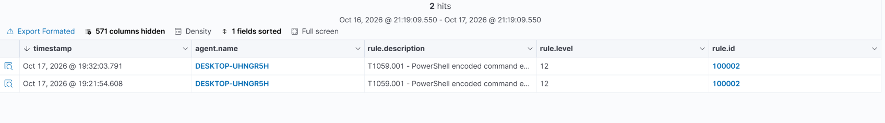
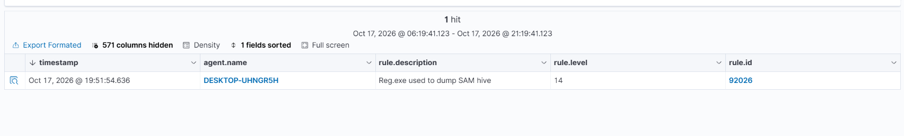
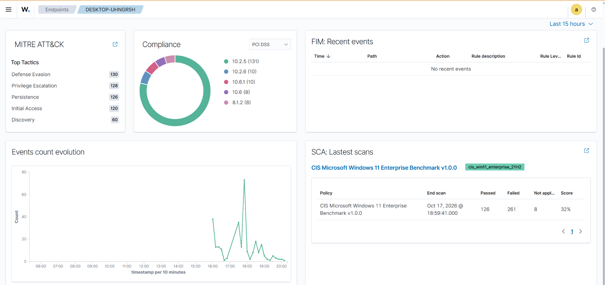

# Wazuh SOC Homelab


A fully functional Security Operations Center (SOC) homelab built to simulate real-world attack scenarios and test detection capabilities using Wazuh SIEM, Sysmon, and custom detection rules mapped to MITRE ATT&CK.

---

## Architecture

```
┌─────────────────────────────────────────────────────────┐
│                    ATTACK SURFACE                        │
│                                                         │
│   ┌──────────────────────┐                              │
│   │  Windows 11 VM       │  ← Victim endpoint           │
│   │  + Sysmon v15.22     │                              │
│   │  + Wazuh Agent 4.9.2 │                              │
│   └──────────┬───────────┘                              │
│              │ TCP 1514                                  │
│              ▼                                           │
│   ┌──────────────────────┐                              │
│   │  Wazuh Stack (Docker)│                              │
│   │  ├── Manager         │  ← Detection engine          │
│   │  ├── Indexer         │  ← Log storage               │
│   │  └── Dashboard       │  ← https://localhost         │
│   └──────────────────────┘                              │
└─────────────────────────────────────────────────────────┘
```

---

## Techniques Simulated

| # | MITRE ID | Technique | Wazuh Rule | Level | Detected |
|---|----------|-----------|------------|-------|----------|
| 1 | T1059.001 | PowerShell Encoded Command | 100002 (custom) | 12 | ✅ |
| 2 | T1136.001 | Create Local Account | 60109 | 8 | ✅ |
| 3 | T1053.005 | Scheduled Task | 100002 | 12 | ✅ |
| 4 | T1110 | Brute Force | 60122 | 5 | ✅ |
| 5 | T1003 | Credential Dumping (SAM) | 92026 | 14 | ✅ |
| 6 | T1055 | Process Injection | 92213 | 15 | ✅ |

---

## Screenshots

**Custom rule 100002 firing on encoded PowerShell (T1059.001, level 12)**



**Rule 92026: reg.exe used to dump the SAM hive (T1003, level 14)**



**Endpoint overview: top MITRE ATT&CK tactics, events over time, and compliance scans**



---

## Custom Detection Rule

Written in `detection-rules/local_rules.xml` — maps encoded PowerShell execution to MITRE T1059.001:

```xml
<rule id="100002" level="12">
  <if_sid>61603</if_sid>
  <field name="win.eventdata.commandLine" type="pcre2">(?i)powershell.+(-enc|-EncodedCommand)</field>
  <description>T1059.001 - PowerShell encoded command execution detected</description>
  <mitre>
    <id>T1059.001</id>
  </mitre>
  <group>attack,powershell,t1059,</group>
</rule>
```

---

## Stack

| Component | Version | Role |
|-----------|---------|------|
| Wazuh Manager | 4.9.2 | SIEM / detection engine |
| Wazuh Indexer | 4.9.2 | Log storage (OpenSearch) |
| Wazuh Dashboard | 4.9.2 | Visualization |
| Sysmon | v15.22 | Endpoint telemetry |
| VirtualBox | 7.2.12 | Hypervisor |
| Docker Desktop | 29.6.2 | Container runtime |
| OS (victim) | Windows 11 25H2 Enterprise Eval | Target endpoint |

---

## Repo Structure

```
wazuh-soc-homelab/
├── detection-rules/        # Custom Wazuh XML rules
├── attack-simulations/     # PowerShell attack scripts (per MITRE technique)
├── dashboards/screenshots/ # Wazuh dashboard evidence
└── incident-reports/       # NIST 800-61 formatted IR reports
```

---

## Incident Reports

Three structured incident reports following NIST SP 800-61 format:

- [IR-001 — PowerShell Encoded Command (T1059.001)](incident-reports/IR-001_T1059001_PowerShell.md)
- [IR-002 — Credential Dumping via SAM Hive (T1003)](incident-reports/IR-002_T1003_CredentialDumping.md)
- [IR-003 — Brute Force Authentication (T1110)](incident-reports/IR-003_T1110_BruteForce.md)

---

## How it works

The Wazuh stack (manager, indexer, and dashboard, version 4.9.2) runs in Docker on a Windows 11 machine. A Windows 11 VM in VirtualBox is the victim endpoint. It runs Sysmon v15.22 with the SwiftOnSecurity config, and the Wazuh agent forwards its logs to the manager, including the Microsoft-Windows-Sysmon/Operational channel.

## A problem I ran into

At first the agent was connected and events were flowing, but I got no process creation alerts. The Sysmon event channel was not in the agent config by default. Adding one `localfile` block for it fixed that. Lesson: check your log sources before trusting your detections.

---

## Author

**Naim Hariri** — CS graduate (BAU, Cybersecurity track)
Targeting junior SOC analyst roles.

[GitHub](https://github.com/chefxx1) · [LinkedIn](https://linkedin.com/in/naim-hariri)
